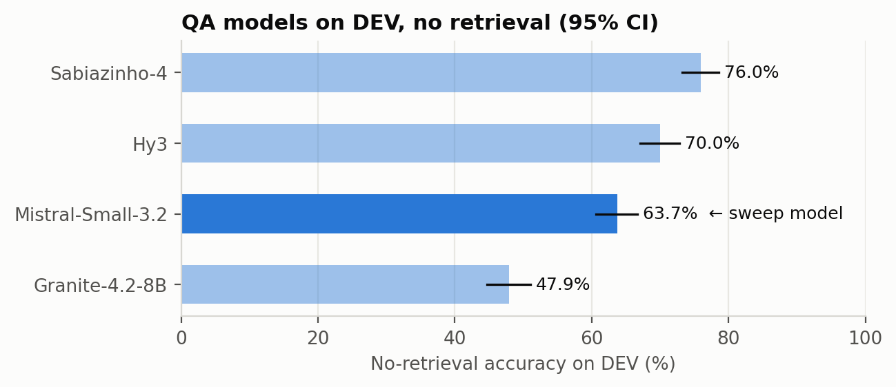
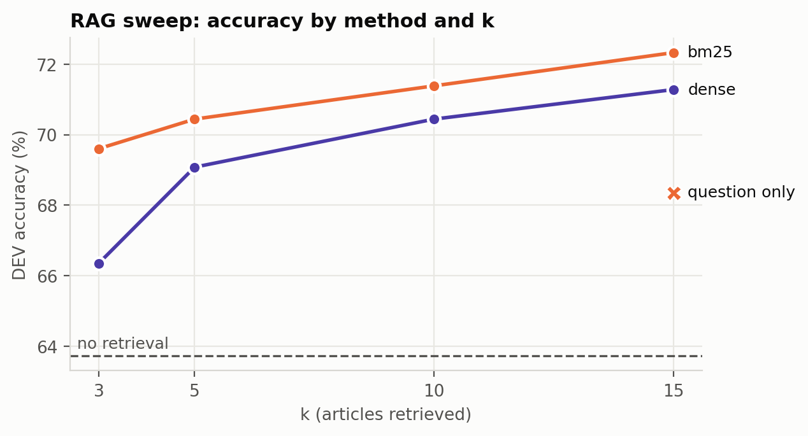
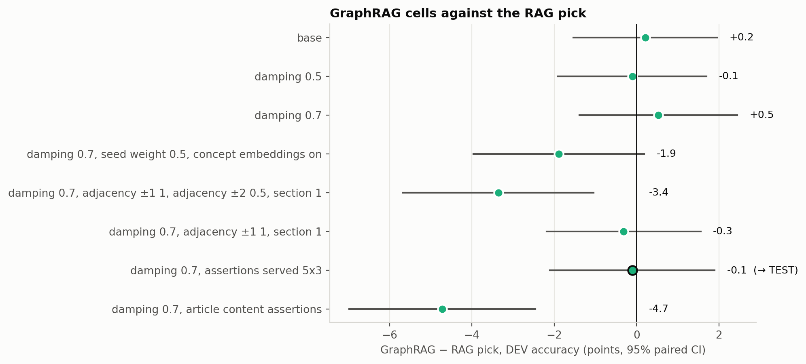
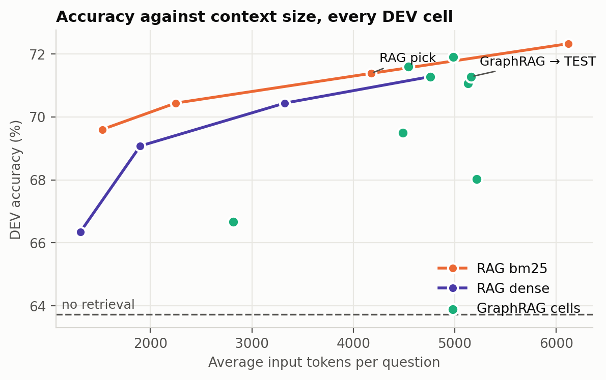

# DEV sweeps — retrieval tuning

- Split: DEV, 954 questions, disjoint from TEST.
- Sweep model: **Mistral-Small-3.2** (`mistral` in `run_eval.QA_MODELS`).
- Pick rule (both sweeps): most accurate cell, unless a cell within 1 point uses fewer input tokens.
- Context cap: 12,000 tokens for both retrievers.

## 1. No retrieval — sweep-model choice

- Ranking (weakest first): Granite-4.2-8B 47.9% < Mistral-Small-3.2 63.7% < Hy3 70.0% < Sabiazinho-4 76.0%.
- Sweep model rank: 2 of 4.

| Model | Run | Accuracy | 95% CI | No answer | Tokens/q | Cost |
|---|---|---:|---:|---:|---:|---:|
| Granite-4.2-8B | `run_124` | 47.9% | 44.7%–51.1% | 0 | 467 | $0.069 (R$0.356) |
| Mistral-Small-3.2 | `run_098` | 63.7% | 60.6%–66.7% | 0 | 389 | $0.046 (R$0.239) |
| Hy3 | `run_099` | 70.0% | 67.0%–72.8% | 5 | 461 | $0.099 (R$0.512) |
| Sabiazinho-4 | `run_100` | 76.0% | 73.2%–78.6% | 0 | 422 | $0.124 (R$0.639) |

## 2. RAG sweep

- Grid: 2 methods × 4 k values = 8 cells.
- Most accurate: bm25 k=15 (72.3%).
- Rule pick: bm25 k=10 (71.4%, 4,176 tokens/q).
- TEST config (`run_eval`): bm25 k=10 — matches the rule.
- bm25: 69.6%–72.3% across k; largest p vs no retrieval <0.001.
- dense: 66.4%–71.3% across k; largest p vs no retrieval 0.048.
- Question-only query (bm25 k=15): 68.3%, -4.0 vs question + choices (p <0.001).

| Method | k | Query | Run | Accuracy | vs no retrieval | 95% CI | p | Tokens/q | Cost |  |
|---|---:|---|---|---:|---:|---:|---:|---:|---:|---|
| bm25 | 3 | question + choices | `run_101` | 69.6% | +5.9 | [+3.4, +8.4] | <0.001 | 1,525 | $0.133 (R$0.686) |  |
| bm25 | 5 | question + choices | `run_102` | 70.4% | +6.7 | [+4.1, +9.3] | <0.001 | 2,249 | $0.185 (R$0.957) |  |
| bm25 | 10 | question + choices | `run_103` | 71.4% | +7.7 | [+5.1, +10.2] | <0.001 | 4,176 | $0.324 (R$1.673) | **TEST** |
| bm25 | 15 | question + choices | `run_104` | 72.3% | +8.6 | [+5.9, +11.3] | <0.001 | 6,120 | $0.463 (R$2.396) |  |
| dense | 3 | question + choices | `run_105` | 66.4% | +2.6 | [+0.1, +5.1] | 0.048 | 1,311 | $0.117 (R$0.607) |  |
| dense | 5 | question + choices | `run_106` | 69.1% | +5.3 | [+2.8, +7.9] | <0.001 | 1,900 | $0.160 (R$0.825) |  |
| dense | 10 | question + choices | `run_107` | 70.4% | +6.7 | [+4.1, +9.3] | <0.001 | 3,326 | $0.263 (R$1.358) |  |
| dense | 15 | question + choices | `run_108` | 71.3% | +7.5 | [+5.0, +10.1] | <0.001 | 4,757 | $0.366 (R$1.891) |  |
| bm25 | 15 | question only | `run_109` | 68.3% | +4.6 | [+2.1, +7.1] | <0.001 | 6,096 | $0.462 (R$2.388) |  |

## 3. GraphRAG sweep (Personalized PageRank walk)

- 8 cells, each vs the RAG pick on the same 954 questions.
- Fixed across cells: BM25 start top-N 50, mentions 1, entity edges 1, citations 1, degree norm 0, keep BM25 top 0, walk seeds all, k 10.
- Base cell (`run_110`): damping 0.3, seed weight 0.3, concept embeddings off, adjacency ±1 0.5, adjacency ±2 0, section 0.5, assertions served off, article content text.
- GraphRAG − RAG: -4.7 to +0.5 points; significantly better in 0, significantly worse in 2, tied in 6 of 8 cells (p<0.05).
- Rule pick: `run_110` (base, 71.6%, 4,543 tokens/q).
- Carried to TEST: `run_116` (damping 0.7, assertions served 5x3, 71.3%) — not the rule pick; -0.3 vs it (p 0.828).

| Run | Change vs base | Accuracy | vs RAG pick | 95% CI | p | GraphRAG-only / RAG-only right | Tokens/q | Cost |  |
|---|---|---:|---:|---:|---:|---:|---:|---:|---|
| `run_110` | base | 71.6% | +0.2 | [-1.5, +2.0] | 0.906 | 37 / 35 | 4,543 | $0.350 (R$1.810) |  |
| `run_111` | damping 0.5 | 71.3% | -0.1 | [-1.9, +1.7] | 1.000 | 38 / 39 | 4,760 | $0.366 (R$1.890) |  |
| `run_112` | damping 0.7 | 71.9% | +0.5 | [-1.4, +2.4] | 0.668 | 46 / 41 | 4,983 | $0.382 (R$1.973) |  |
| `run_113` | damping 0.7, seed weight 0.5, concept embeddings on | 69.5% | -1.9 | [-4.0, +0.2] | 0.092 | 42 / 60 | 4,487 | $0.346 (R$1.791) |  |
| `run_114` | damping 0.7, adjacency ±1 1, adjacency ±2 0.5, section 1 | 68.0% | -3.4 | [-5.7, -1.0] | 0.006 | 48 / 80 | 5,218 | $0.378 (R$1.952) |  |
| `run_115` | damping 0.7, adjacency ±1 1, section 1 | 71.1% | -0.3 | [-2.2, +1.6] | 0.826 | 40 / 43 | 5,132 | $0.393 (R$2.029) |  |
| `run_116` | damping 0.7, assertions served 5x3 | 71.3% | -0.1 | [-2.1, +1.9] | 1.000 | 47 / 48 | 5,161 | $0.394 (R$2.039) | **TEST** |
| `run_128` | damping 0.7, article content assertions | 66.7% | -4.7 | [-7.0, -2.5] | <0.001 | 39 / 84 | 2,818 | $0.226 (R$1.169) |  |

### Same walk, different context

- Pairs of cells with the same walk settings that differ only in what they serve. Where every article is shared, the difference isolates the representation; fewer shared articles mean the runs also chose differently.

| Runs | Serves | Shared articles / q | Accuracy | Δ | 95% CI | p | Won / lost |
|---|---|---:|---:|---:|---:|---:|---:|
| `run_112` → `run_116` | text → text + assertions 5x3 | 8.7 | 71.9% → 71.3% | -0.6 | [-2.1, +0.9] | 0.496 | 24 / 30 |
| `run_112` → `run_128` | text → assertions | 8.7 | 71.9% → 66.7% | -5.2 | [-7.4, -3.1] | <0.001 | 31 / 81 |
| `run_116` → `run_128` | text + assertions 5x3 → assertions | 10.0 | 71.3% → 66.7% | -4.6 | [-6.8, -2.4] | <0.001 | 37 / 81 |

## 4. Context size

- Each DEV cell's accuracy against its average input tokens; the dashed line is no retrieval.

## 5. Tuning effort

| Condition | DEV runs | Cost |
|---|---:|---:|
| No retrieval | 4 | $0.34 (R$1.75) |
| RAG | 9 | $2.47 (R$12.78) |
| GraphRAG | 8 | $2.83 (R$14.65) |
