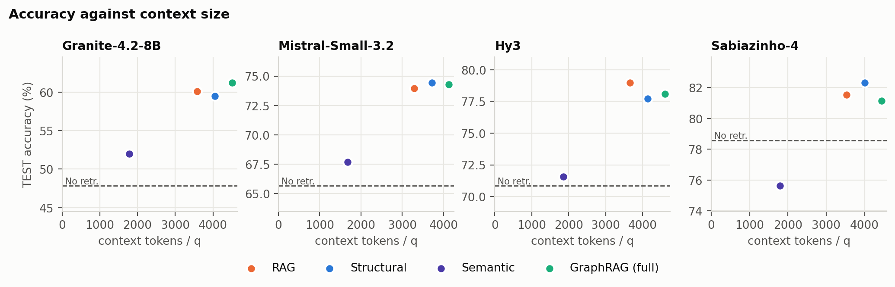
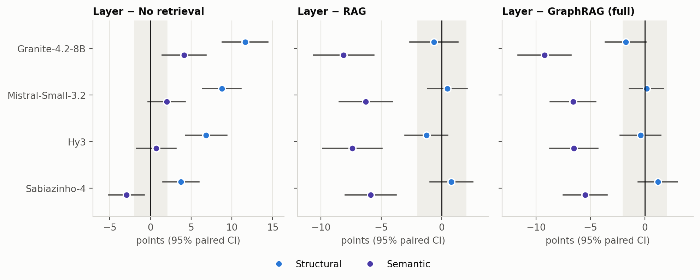

# TEST — GraphRAG layer ablation

- Split: TEST, 1256 questions. The ablations are analyses of the fixed TEST config; nothing is selected from them.
- Models (4, weakest first): Granite-4.2-8B, Mistral-Small-3.2, Hy3, Sabiazinho-4.
- GraphRAG (full): `ppr_d0.7_seed0.3_noemb_bm50_men1_sem1_cit1_adj0.5_adj2_0_sec0.5_dn0_keep0_ann5x3_k10`.
- Structural: `ppr_d0.7_seed0.3_noemb_bm50_men0_sem0_cit1_adj0.5_adj2_0_sec0.5_dn0_keep0_seeds_references_k10` — walk over citations, art. N±1 and sections (parser-built, no LLM), started from BM25 and the articles the question cites; article text.
- Semantic: `ppr_d0.7_seed0.3_noemb_bm50_men1_sem1_cit0_adj0_adj2_0_sec0_dn0_keep0_seeds_entities_assertions_nopath_prov_k10` — walk over the extracted entities, started from BM25 and the linked entities; each article as its assertions in force, no text.
- RAG: bm25 k=10. Every retrieval condition serves 10 articles under a 12,000-token cap.
- Paired tests: McNemar with continuity correction; 95% paired intervals. Equivalent: the interval lies inside ±2 points.

## Headline

- **Structural − No retrieval:** +3.7 to +11.6 points; significantly above for 4 of 4, below for 0; equivalent within ±2 for 0.
- **Structural − RAG:** -1.3 to +0.8 points; significantly above for 0 of 4, below for 0; equivalent within ±2 for 0.
- **Structural − GraphRAG (full):** -1.8 to +1.2 points; significantly above for 0 of 4, below for 0; equivalent within ±2 for 1.
- **Structural keeps** 87% to 147% of the full config's gain (weakest to strongest: 87%, 102%, 95%, 147%) with 90% of its context tokens.
- **Semantic − No retrieval:** -2.9 to +4.1 points; significantly above for 1 of 4, below for 1; equivalent within ±2 for 0.
- **Semantic − RAG:** -8.1 to -5.9 points; significantly above for 0 of 4, below for 4; equivalent within ±2 for 0.
- **Semantic − GraphRAG (full):** -9.2 to -5.5 points; significantly above for 0 of 4, below for 4; equivalent within ±2 for 0.
- **Semantic keeps** -116% to 31% of the full config's gain (weakest to strongest: 31%, 23%, 10%, -116%) with 40% of its context tokens.

## 1. Accuracy and context size

| Model | No retrieval | RAG | Structural | Semantic | GraphRAG (full) |
|---|---:|---:|---:|---:|---:|
| Granite-4.2-8B | 47.9% | 60.1% | 59.5% | 52.0% | 61.2% |
| Mistral-Small-3.2 | 65.7% | 74.0% | 74.4% | 67.7% | 74.3% |
| Hy3 | 70.9% | 79.0% | 77.7% | 71.6% | 78.1% |
| Sabiazinho-4 | 78.6% | 81.5% | 82.3% | 75.6% | 81.1% |

- Context tokens / q: input tokens above the no-retrieval prompt of the same model.

| Model | RAG | Structural | Semantic | GraphRAG (full) |
|---|---:|---:|---:|---:|
| Granite-4.2-8B | 3,576 | 4,048 | 1,787 | 4,512 |
| Mistral-Small-3.2 | 3,285 | 3,724 | 1,680 | 4,128 |
| Hy3 | 3,654 | 4,140 | 1,851 | 4,609 |
| Sabiazinho-4 | 3,530 | 4,000 | 1,796 | 4,444 |

## 2. Paired comparisons

| Comparison | Model | Δ (points) | 95% CI | p | Won / lost | Within ±2 |
|---|---|---:|---:|---:|---:|---|
| Structural − No retrieval | Granite-4.2-8B | +11.6 | [+8.8, +14.4] | <0.001 | 244 / 98 | no |
| Structural − No retrieval | Mistral-Small-3.2 | +8.8 | [+6.4, +11.1] | <0.001 | 176 / 66 | no |
| Structural − No retrieval | Hy3 | +6.8 | [+4.3, +9.4] | <0.001 | 178 / 92 | no |
| Structural − No retrieval | Sabiazinho-4 | +3.7 | [+1.5, +6.0] | 0.001 | 126 / 79 | no |
| Structural − RAG | Granite-4.2-8B | -0.6 | [-2.6, +1.3] | 0.582 | 77 / 85 | no |
| Structural − RAG | Mistral-Small-3.2 | +0.5 | [-1.2, +2.1] | 0.634 | 58 / 52 | no |
| Structural − RAG | Hy3 | -1.3 | [-3.0, +0.5] | 0.185 | 56 / 72 | no |
| Structural − RAG | Sabiazinho-4 | +0.8 | [-1.0, +2.6] | 0.426 | 69 / 59 | no |
| Structural − GraphRAG (full) | Granite-4.2-8B | -1.8 | [-3.6, +0.1] | 0.080 | 61 / 83 | no |
| Structural − GraphRAG (full) | Mistral-Small-3.2 | +0.2 | [-1.4, +1.7] | 0.921 | 52 / 50 | yes |
| Structural − GraphRAG (full) | Hy3 | -0.4 | [-2.3, +1.5] | 0.738 | 69 / 74 | no |
| Structural − GraphRAG (full) | Sabiazinho-4 | +1.2 | [-0.6, +3.0] | 0.225 | 74 / 59 | no |
| Semantic − No retrieval | Granite-4.2-8B | +4.1 | [+1.4, +6.8] | 0.003 | 176 / 124 | no |
| Semantic − No retrieval | Mistral-Small-3.2 | +2.0 | [-0.3, +4.3] | 0.098 | 118 / 93 | no |
| Semantic − No retrieval | Hy3 | +0.7 | [-1.7, +3.1] | 0.606 | 125 / 116 | no |
| Semantic − No retrieval | Sabiazinho-4 | -2.9 | [-5.1, -0.8] | 0.010 | 79 / 116 | no |
| Semantic − RAG | Granite-4.2-8B | -8.1 | [-10.6, -5.6] | <0.001 | 82 / 184 | no |
| Semantic − RAG | Mistral-Small-3.2 | -6.3 | [-8.5, -4.1] | <0.001 | 63 / 142 | no |
| Semantic − RAG | Hy3 | -7.4 | [-9.9, -5.0] | <0.001 | 80 / 173 | no |
| Semantic − RAG | Sabiazinho-4 | -5.9 | [-8.0, -3.8] | <0.001 | 56 / 130 | no |
| Semantic − GraphRAG (full) | Granite-4.2-8B | -9.2 | [-11.7, -6.8] | <0.001 | 69 / 185 | no |
| Semantic − GraphRAG (full) | Mistral-Small-3.2 | -6.6 | [-8.7, -4.5] | <0.001 | 52 / 135 | no |
| Semantic − GraphRAG (full) | Hy3 | -6.5 | [-8.8, -4.3] | <0.001 | 63 / 145 | no |
| Semantic − GraphRAG (full) | Sabiazinho-4 | -5.5 | [-7.5, -3.5] | <0.001 | 51 / 120 | no |

## 3. Gain retained

- (layer − no retrieval) / (full − no retrieval): share of the full config's gain the layer keeps alone. Negative: below no retrieval. Unstable when the full gain is small.

| Model | Full gain | Structural retained | Structural context share | Semantic retained | Semantic context share |
|---|---:|---:|---:|---:|---:|
| Granite-4.2-8B | +13.4 | 87% | 90% | 31% | 40% |
| Mistral-Small-3.2 | +8.6 | 102% | 90% | 23% | 41% |
| Hy3 | +7.2 | 95% | 90% | 10% | 40% |
| Sabiazinho-4 | +2.5 | 147% | 90% | -116% | 40% |

## 4. Evidence overlap

| Layer | Shared with full (of 10) | Shared with RAG |
|---|---:|---:|
| Structural | 5.3 | 4.7 |
| Semantic | 7.4 | 5.6 |

- Layer − full by articles served in common (pooled over models). Where most articles are shared, the gap is mostly what each serves about them, not which.

| Layer | Shared with full | Questions | Layer − full | p | Won / lost |
|---|---|---:|---:|---:|---:|
| Structural | 0–3 | 143 | -0.3 | 0.901 | 31 / 33 |
| Structural | 4–6 | 865 | -0.2 | 0.802 | 195 / 201 |
| Structural | 7–10 | 248 | -0.2 | 0.899 | 30 / 32 |
| Semantic | 0–3 | 4 | -18.8 | 0.248 | 0 / 3 |
| Semantic | 4–6 | 325 | -4.6 | <0.001 | 68 / 128 |
| Semantic | 7–10 | 927 | -7.7 | <0.001 | 167 / 454 |

## 5. Rescue and harm

- Rescue: share of questions wrong without retrieval that the condition gets right. Harm: share right without retrieval that it gets wrong.

| Model | RAG rescue | RAG harm | Structural rescue | Structural harm | Semantic rescue | Semantic harm | GraphRAG (full) rescue | GraphRAG (full) harm |
|---|---:|---:|---:|---:|---:|---:|---:|---:|
| Granite-4.2-8B | 38.9% | 16.8% | 37.3% | 16.3% | 26.9% | 20.6% | 39.2% | 14.8% |
| Mistral-Small-3.2 | 39.7% | 8.1% | 40.8% | 8.0% | 27.4% | 11.3% | 40.4% | 8.0% |
| Hy3 | 51.4% | 9.7% | 48.6% | 10.3% | 34.2% | 13.0% | 48.1% | 9.6% |
| Sabiazinho-4 | 44.6% | 8.4% | 46.8% | 8.0% | 29.4% | 11.8% | 43.5% | 8.6% |

## 6. Citation grounding

- Among answers that cite an article number: share citing one the context did not contain. Semantic contexts name each article in its header, so the check applies.

| Model | RAG | Structural | Semantic | GraphRAG (full) |
|---|---:|---:|---:|---:|
| Granite-4.2-8B | 17.9% (cites 86%) | 17.7% (cites 85%) | 6.1% (cites 84%) | 16.9% (cites 88%) |
| Mistral-Small-3.2 | 25.7% (cites 95%) | 29.4% (cites 95%) | 22.3% (cites 96%) | 24.7% (cites 96%) |
| Hy3 | 15.4% (cites 97%) | 19.7% (cites 96%) | 15.2% (cites 96%) | 16.5% (cites 97%) |
| Sabiazinho-4 | 28.0% (cites 69%) | 31.9% (cites 67%) | 26.1% (cites 67%) | 25.9% (cites 69%) |

## 7. Runs and cost

| Model | Condition | Run | No answer | Hit token cap | Input tok/q | Output tok/q | Cost |
|---|---|---|---:|---:|---:|---:|---:|
| Granite-4.2-8B | No retrieval | `run_125` | 0 | 44 | 401 | 156 | $0.077 (R$0.396) |
| Granite-4.2-8B | RAG | `run_126` | 0 | 164 | 3,977 | 288 | $0.380 (R$1.966) |
| Granite-4.2-8B | Structural | `run_129` | 0 | 151 | 4,449 | 295 | $0.407 (R$2.103) |
| Granite-4.2-8B | Semantic | `run_132` | 0 | 134 | 2,188 | 291 | $0.246 (R$1.272) |
| Granite-4.2-8B | GraphRAG (full) | `run_127` | 0 | 136 | 4,913 | 291 | $0.447 (R$2.310) |
| Mistral-Small-3.2 | No retrieval | `run_094` | 0 | 0 | 330 | 94 | $0.055 (R$0.283) |
| Mistral-Small-3.2 | RAG | `run_120` | 0 | 1 | 3,615 | 128 | $0.373 (R$1.927) |
| Mistral-Small-3.2 | Structural | `run_130` | 0 | 0 | 4,055 | 128 | $0.414 (R$2.141) |
| Mistral-Small-3.2 | Semantic | `run_133` | 1 | 0 | 2,011 | 124 | $0.221 (R$1.141) |
| Mistral-Small-3.2 | GraphRAG (full) | `run_122` | 0 | 1 | 4,459 | 128 | $0.452 (R$2.338) |
| Hy3 | No retrieval | `run_095` | 9 | 0 | 391 | 83 | $0.115 (R$0.595) |
| Hy3 | RAG | `run_121` | 13 | 1 | 4,045 | 152 | $0.739 (R$3.823) |
| Hy3 | Structural | `run_131` | 16 | 2 | 4,531 | 155 | $0.795 (R$4.110) |
| Hy3 | Semantic | `run_134` | 18 | 0 | 2,242 | 148 | $0.442 (R$2.283) |
| Hy3 | GraphRAG (full) | `run_123` | 11 | 0 | 4,999 | 155 | $0.881 (R$4.557) |
| Sabiazinho-4 | No retrieval | `run_096` | 0 | 32 | 356 | 119 | $0.141 (R$0.731) |
| Sabiazinho-4 | RAG | `run_118` | 1 | 67 | 3,886 | 191 | $0.791 (R$4.090) |
| Sabiazinho-4 | Structural | `run_135` | 2 | 65 | 4,357 | 196 | $0.874 (R$4.518) |
| Sabiazinho-4 | Semantic | `run_136` | 1 | 74 | 2,153 | 195 | $0.499 (R$2.579) |
| Sabiazinho-4 | GraphRAG (full) | `run_119` | 1 | 64 | 4,800 | 189 | $0.945 (R$4.884) |

- Ablation runs cost: $3.90 (R$20.15).
