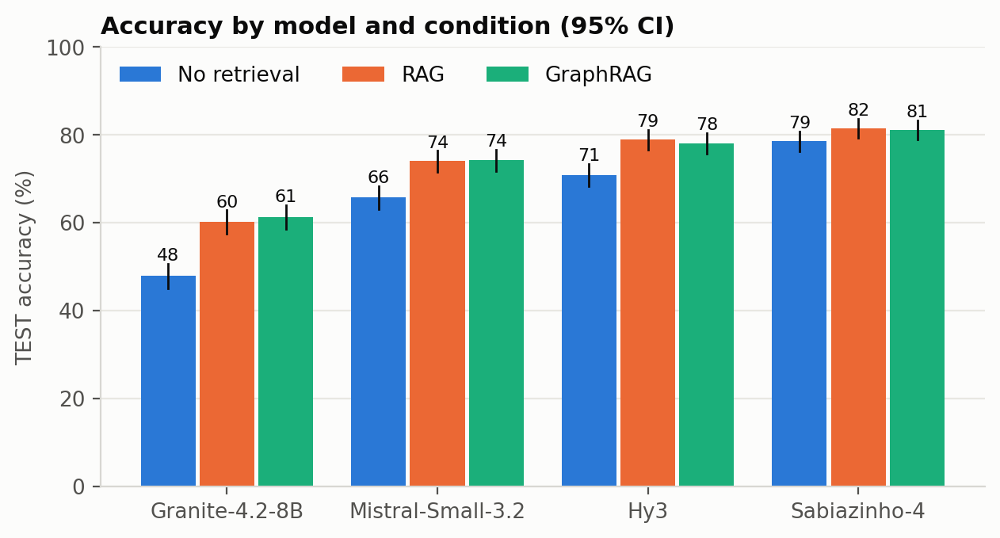
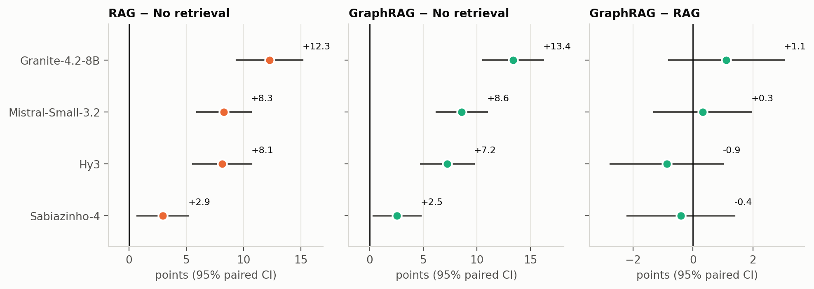
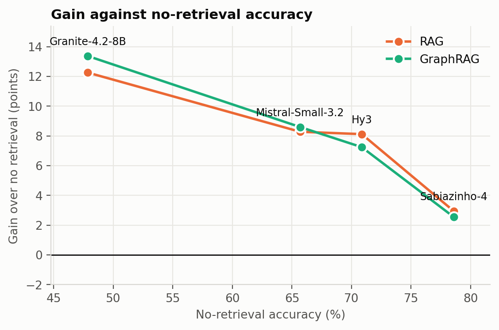
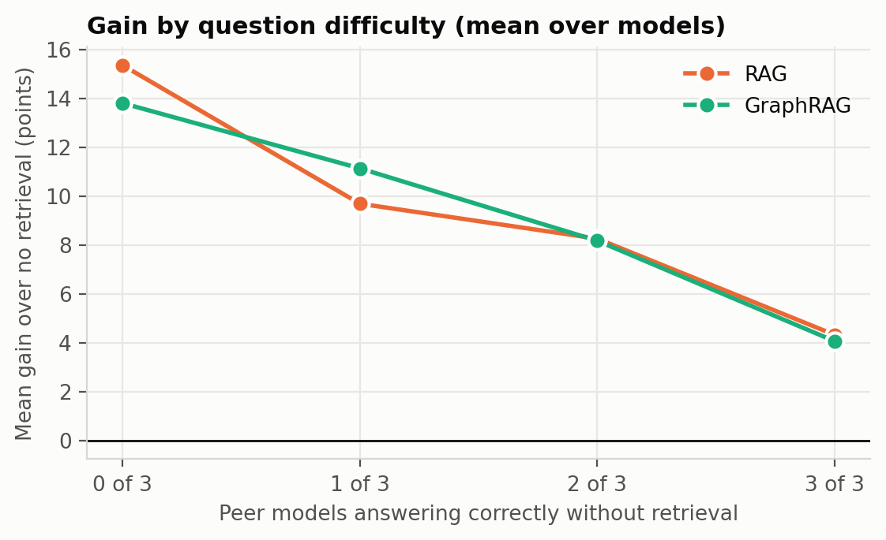
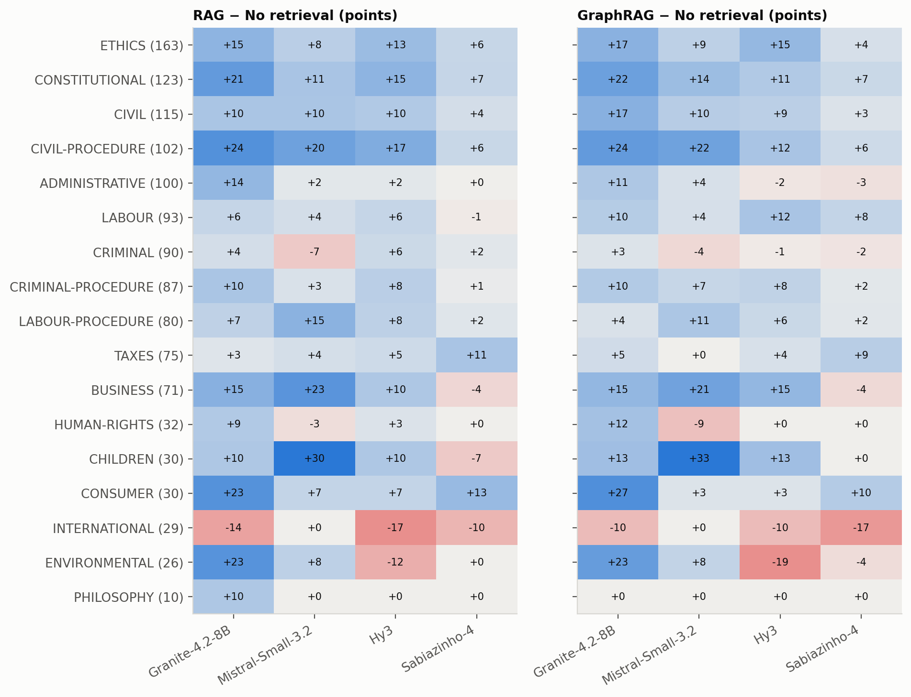
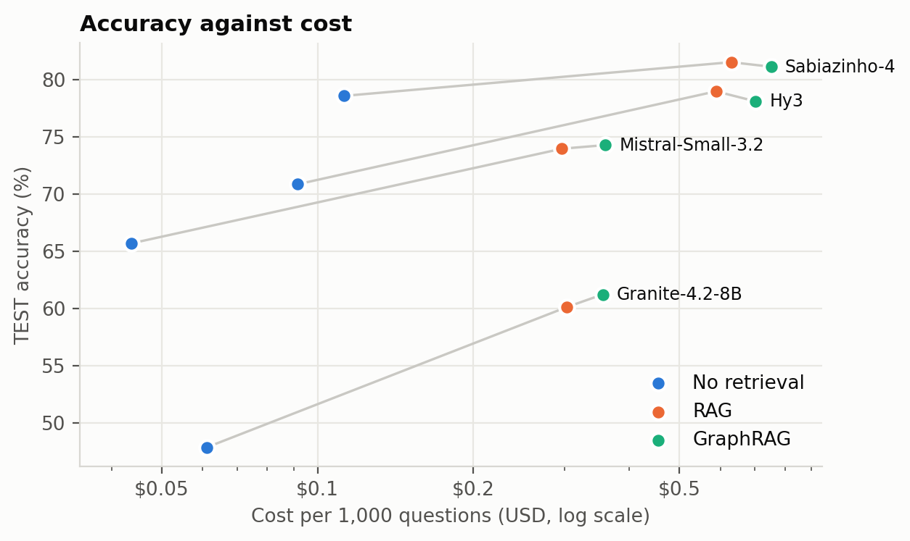

# TEST — No retrieval vs RAG vs GraphRAG

- Split: TEST, 1256 questions; reported once, never tuned on.
- Models (4, weakest first): Granite-4.2-8B, Mistral-Small-3.2, Hy3, Sabiazinho-4.
- RAG: bm25 k=10. GraphRAG: `ppr_d0.7_seed0.3_noemb_bm50_men1_sem1_cit1_adj0.5_adj2_0_sec0.5_dn0_keep0_ann5x3_k10`. Both capped at 12,000 context tokens; configs chosen on DEV (see `dev_sweeps.md`); layer ablation of the GraphRAG config in `layers.md`.
- Accuracy counts every question; no-answers count as wrong. Paired tests: McNemar with continuity correction; 95% paired intervals.

## Headline

- **RAG vs no retrieval:** +2.9 to +12.3 points; significant gain for 4 of 4 models.
- **GraphRAG vs no retrieval:** +2.5 to +13.4 points; significant gain for 4 of 4 models.
- **GraphRAG vs RAG:** -0.9 to +1.1 points; significant for 0 of 4 models; 2 above RAG, 2 below.
- **RAG gain vs baseline:** +12.3 > +8.3 > +8.1 > +2.9 from weakest to strongest model — shrinks at every step.
- **GraphRAG gain vs baseline:** +13.4 > +8.6 > +7.2 > +2.5 from weakest to strongest model — shrinks at every step.
- **Difficulty:** mean GraphRAG gain +13.8 on questions no peer answers vs +4.1 on those every peer answers (RAG +15.4 vs +4.3).
- **Evidence:** GraphRAG and RAG share 5.0 of 10 articles per question on average (mean Jaccard 0.35).

## 1. Accuracy

| Model | No retrieval | RAG | GraphRAG | 95% CI (no retr.) | 95% CI (RAG) | 95% CI (GraphRAG) |
|---|---:|---:|---:|---:|---:|---:|
| Granite-4.2-8B | 47.9% | 60.1% | 61.2% | 45.1%–50.6% | 57.4%–62.8% | 58.5%–63.9% |
| Mistral-Small-3.2 | 65.7% | 74.0% | 74.3% | 63.0%–68.3% | 71.5%–76.3% | 71.8%–76.6% |
| Hy3 | 70.9% | 79.0% | 78.1% | 68.3%–73.3% | 76.6%–81.1% | 75.7%–80.3% |
| Sabiazinho-4 | 78.6% | 81.5% | 81.1% | 76.2%–80.8% | 79.3%–83.6% | 78.9%–83.2% |

## 2. Paired gains

| Model | Comparison | Δ (points) | 95% CI | p | Won / lost |
|---|---|---:|---:|---:|---:|
| Granite-4.2-8B | RAG − No retrieval | +12.3 | [+9.4, +15.1] | <0.001 | 255 / 101 |
| Granite-4.2-8B | GraphRAG − No retrieval | +13.4 | [+10.6, +16.2] | <0.001 | 257 / 89 |
| Granite-4.2-8B | GraphRAG − RAG | +1.1 | [-0.8, +3.0] | 0.288 | 82 / 68 |
| Mistral-Small-3.2 | RAG − No retrieval | +8.3 | [+5.9, +10.6] | <0.001 | 171 / 67 |
| Mistral-Small-3.2 | GraphRAG − No retrieval | +8.6 | [+6.2, +11.0] | <0.001 | 174 / 66 |
| Mistral-Small-3.2 | GraphRAG − RAG | +0.3 | [-1.3, +1.9] | 0.773 | 56 / 52 |
| Hy3 | RAG − No retrieval | +8.1 | [+5.6, +10.7] | <0.001 | 188 / 86 |
| Hy3 | GraphRAG − No retrieval | +7.2 | [+4.8, +9.7] | <0.001 | 176 / 85 |
| Hy3 | GraphRAG − RAG | -0.9 | [-2.8, +1.0] | 0.406 | 67 / 78 |
| Sabiazinho-4 | RAG − No retrieval | +2.9 | [+0.7, +5.2] | 0.012 | 120 / 83 |
| Sabiazinho-4 | GraphRAG − No retrieval | +2.5 | [+0.3, +4.8] | 0.029 | 117 / 85 |
| Sabiazinho-4 | GraphRAG − RAG | -0.4 | [-2.2, +1.4] | 0.727 | 63 / 68 |

### Mean over models

- Mean difference over the 4 models, with a 95% bootstrap interval (10,000 resamples of the 1256 questions, each keeping every model's answers).

| Comparison | Mean Δ (points) | 95% CI |
|---|---:|---:|
| RAG − No retrieval | +7.9 | [+6.3, +9.5] |
| GraphRAG − No retrieval | +7.9 | [+6.4, +9.5] |
| GraphRAG − RAG | +0.0 | [-1.0, +1.1] |

## 3. Gain against baseline strength

## 4. Rescue and harm

- Rescue: share of questions wrong without retrieval that retrieval gets right. Harm: share right without retrieval that retrieval gets wrong.

| Model | Wrong / right w/o retrieval | RAG rescue | RAG harm | GraphRAG rescue | GraphRAG harm |
|---|---:|---:|---:|---:|---:|
| Granite-4.2-8B | 655 / 601 | 38.9% | 16.8% | 39.2% | 14.8% |
| Mistral-Small-3.2 | 431 / 825 | 39.7% | 8.1% | 40.4% | 8.0% |
| Hy3 | 366 / 890 | 51.4% | 9.7% | 48.1% | 9.6% |
| Sabiazinho-4 | 269 / 987 | 44.6% | 8.4% | 43.5% | 8.6% |

## 5. Question difficulty

- Each question is banded, per model, by how many of the *other* models answer it without retrieval; no model is graded against its own answer.

| Peers correct | Band size (range over models) | Mean RAG gain | Mean GraphRAG gain |
|---|---:|---:|---:|
| 0 of 3 | 124–180 | +15.4 | +13.8 |
| 1 of 3 | 207–276 | +9.7 | +11.1 |
| 2 of 3 | 280–459 | +8.3 | +8.2 |
| 3 of 3 | 425–645 | +4.3 | +4.1 |

## 6. Subjects

- Means over the models; subjects with few questions swing widely.

| Subject | Questions | No retrieval | RAG gain | GraphRAG gain | GraphRAG − RAG |
|---|---:|---:|---:|---:|---:|
| ETHICS | 163 | 74.8% | +10.4 | +11.3 | +0.9 |
| CONSTITUTIONAL | 123 | 59.3% | +13.2 | +13.2 | +0.0 |
| CIVIL | 115 | 63.9% | +8.7 | +9.8 | +1.1 |
| CIVIL-PROCEDURE | 102 | 59.8% | +16.4 | +15.7 | -0.7 |
| ADMINISTRATIVE | 100 | 77.5% | +4.5 | +2.5 | -2.0 |
| LABOUR | 93 | 55.9% | +4.0 | +8.3 | +4.3 |
| CRIMINAL | 90 | 55.8% | +1.4 | -1.1 | -2.5 |
| CRIMINAL-PROCEDURE | 87 | 56.9% | +5.7 | +6.9 | +1.1 |
| LABOUR-PROCEDURE | 80 | 64.7% | +8.1 | +5.9 | -2.2 |
| TAXES | 75 | 62.7% | +5.7 | +4.7 | -1.0 |
| BUSINESS | 71 | 68.7% | +10.9 | +12.0 | +1.1 |
| HUMAN-RIGHTS | 32 | 78.9% | +2.3 | +0.8 | -1.6 |
| CHILDREN | 30 | 63.3% | +10.8 | +15.0 | +4.2 |
| CONSUMER | 30 | 75.8% | +12.5 | +10.8 | -1.7 |
| INTERNATIONAL | 29 | 80.2% | -10.3 | -9.5 | +0.9 |
| ENVIRONMENTAL | 26 | 75.0% | +4.8 | +1.9 | -2.9 |
| PHILOSOPHY | 10 | 97.5% | +2.5 | +0.0 | -2.5 |

### Paired tests by subject

- McNemar per subject and model; cells count models significantly above / below (p<0.05). Holm: adjusted within each comparison over its 68 subject × model tests.

| Subject | Questions | RAG vs none | RAG vs none (Holm) | GraphRAG vs none | GraphRAG vs none (Holm) | GraphRAG vs RAG | GraphRAG vs RAG (Holm) |
|---|---:|---:|---:|---:|---:|---:|---:|
| ETHICS | 163 | 4 / 0 | 2 / 0 | 3 / 0 | 2 / 0 | 0 / 0 | 0 / 0 |
| CONSTITUTIONAL | 123 | 3 / 0 | 1 / 0 | 3 / 0 | 1 / 0 | 0 / 0 | 0 / 0 |
| CIVIL | 115 | 3 / 0 | 0 / 0 | 3 / 0 | 1 / 0 | 0 / 0 | 0 / 0 |
| CIVIL-PROCEDURE | 102 | 3 / 0 | 2 / 0 | 3 / 0 | 2 / 0 | 0 / 0 | 0 / 0 |
| ADMINISTRATIVE | 100 | 1 / 0 | 0 / 0 | 0 / 0 | 0 / 0 | 0 / 0 | 0 / 0 |
| LABOUR | 93 | 0 / 0 | 0 / 0 | 1 / 0 | 0 / 0 | 0 / 0 | 0 / 0 |
| CRIMINAL | 90 | 0 / 0 | 0 / 0 | 0 / 0 | 0 / 0 | 0 / 0 | 0 / 0 |
| CRIMINAL-PROCEDURE | 87 | 0 / 0 | 0 / 0 | 0 / 0 | 0 / 0 | 0 / 0 | 0 / 0 |
| LABOUR-PROCEDURE | 80 | 1 / 0 | 0 / 0 | 1 / 0 | 0 / 0 | 0 / 0 | 0 / 0 |
| TAXES | 75 | 0 / 0 | 0 / 0 | 0 / 0 | 0 / 0 | 0 / 0 | 0 / 0 |
| BUSINESS | 71 | 2 / 0 | 1 / 0 | 3 / 0 | 0 / 0 | 0 / 0 | 0 / 0 |
| HUMAN-RIGHTS | 32 | 0 / 0 | 0 / 0 | 0 / 0 | 0 / 0 | 0 / 0 | 0 / 0 |
| CHILDREN | 30 | 1 / 0 | 0 / 0 | 1 / 0 | 0 / 0 | 0 / 0 | 0 / 0 |
| CONSUMER | 30 | 1 / 0 | 0 / 0 | 1 / 0 | 0 / 0 | 0 / 0 | 0 / 0 |
| INTERNATIONAL | 29 | 0 / 0 | 0 / 0 | 0 / 0 | 0 / 0 | 0 / 0 | 0 / 0 |
| ENVIRONMENTAL | 26 | 0 / 0 | 0 / 0 | 0 / 0 | 0 / 0 | 0 / 0 | 0 / 0 |
| PHILOSOPHY | 10 | 0 / 0 | 0 / 0 | 0 / 0 | 0 / 0 | 0 / 0 | 0 / 0 |

## 7. Evidence overlap (RAG vs GraphRAG)

| Models | Shared articles / q | Mean Jaccard |
|---|---:|---:|
| all (retrieval does not depend on the QA model) | 5.04 | 0.35 |

- GraphRAG − RAG by articles served in common (pooled over models):

| Shared articles | Questions | GraphRAG − RAG | p | Won / lost |
|---|---:|---:|---:|---:|
| 0–3 of 10 | 182 | +1.5 | 0.284 | 49 / 38 |
| 4–6 of 10 | 874 | +0.3 | 0.643 | 194 / 184 |
| 7–10 of 10 | 200 | -2.4 | 0.030 | 25 / 44 |

- Share of the article at each RAG rank (BM25 order) that GraphRAG also serves (Granite-4.2-8B; retrieval does not depend on the QA model):

| RAG rank | Also served by GraphRAG |
|---:|---:|
| 1 | 85.3% |
| 2 | 71.5% |
| 3 | 64.3% |
| 4 | 55.7% |
| 5 | 48.9% |
| 6 | 40.8% |
| 7 | 40.9% |
| 8 | 35.9% |
| 9 | 30.9% |
| 10 | 29.6% |

### Text dated after the cutoff

- BM25 indexes every wording of an article, with all its provisions; the text served is the wording in force at the cutoff. Rebuilding the index per cutoff without later wordings and provisions:
- Articles kept: 8.28 of 10 (17.2% of the served articles change); top 3 kept 94.1% (1256 questions).

| RAG rank | Leaves the top k |
|---:|---:|
| 1 | 4.1% |
| 2 | 5.7% |
| 3 | 7.7% |
| 4 | 8.8% |
| 5 | 11.5% |
| 6 | 13.9% |
| 7 | 17.8% |
| 8 | 25.2% |
| 9 | 34.5% |
| 10 | 42.7% |

### Served wording vs current wording

- Wording served at the cutoff compared with the one in force on 2026-01-01, the latest date the corpus records:
- Served articles that differ: 21.2%; first-ranked article: 20.9%; questions with at least one: 80.6% (1256 questions).

## 8. Citation grounding

- Among answers that cite an article number: share citing one the context did not contain (a comparator between conditions, not recall).

| Model | RAG: cites any | RAG: cites outside context | GraphRAG: cites any | GraphRAG: cites outside context |
|---|---:|---:|---:|---:|
| Granite-4.2-8B | 86.1% | 17.9% | 87.6% | 16.9% |
| Mistral-Small-3.2 | 95.2% | 25.7% | 96.4% | 24.7% |
| Hy3 | 96.9% | 15.4% | 97.1% | 16.5% |
| Sabiazinho-4 | 69.2% | 28.0% | 69.3% | 25.9% |

## 9. Reliability and cost

| Model | Condition | Run | No answer | Hit token cap | Input tok/q | Output tok/q | Cost | Cost / 1k q |
|---|---|---|---:|---:|---:|---:|---:|---:|
| Granite-4.2-8B | No retrieval | `run_125` | 0 | 44 | 401 | 156 | $0.077 (R$0.396) | $0.061 (R$0.315) |
| Granite-4.2-8B | RAG | `run_126` | 0 | 164 | 3,977 | 288 | $0.380 (R$1.966) | $0.303 (R$1.565) |
| Granite-4.2-8B | GraphRAG | `run_127` | 0 | 136 | 4,913 | 291 | $0.447 (R$2.310) | $0.356 (R$1.839) |
| Mistral-Small-3.2 | No retrieval | `run_094` | 0 | 0 | 330 | 94 | $0.055 (R$0.283) | $0.044 (R$0.226) |
| Mistral-Small-3.2 | RAG | `run_120` | 0 | 1 | 3,615 | 128 | $0.373 (R$1.927) | $0.297 (R$1.534) |
| Mistral-Small-3.2 | GraphRAG | `run_122` | 0 | 1 | 4,459 | 128 | $0.452 (R$2.338) | $0.360 (R$1.862) |
| Hy3 | No retrieval | `run_095` | 9 | 0 | 391 | 83 | $0.115 (R$0.595) | $0.092 (R$0.474) |
| Hy3 | RAG | `run_121` | 13 | 1 | 4,045 | 152 | $0.739 (R$3.823) | $0.589 (R$3.044) |
| Hy3 | GraphRAG | `run_123` | 11 | 0 | 4,999 | 155 | $0.881 (R$4.557) | $0.702 (R$3.628) |
| Sabiazinho-4 | No retrieval | `run_096` | 0 | 32 | 356 | 119 | $0.141 (R$0.731) | $0.113 (R$0.582) |
| Sabiazinho-4 | RAG | `run_118` | 1 | 67 | 3,886 | 191 | $0.791 (R$4.090) | $0.630 (R$3.256) |
| Sabiazinho-4 | GraphRAG | `run_119` | 1 | 64 | 4,800 | 189 | $0.945 (R$4.884) | $0.752 (R$3.888) |

- Total TEST cost: $5.40 (R$27.90).
- Hit token cap: output reached `num_predict`; the answer is parsed from whatever was written, so this only matters when it also shows as no answer.
